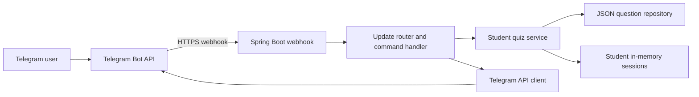

# Telegram Bot Quest — Build Your First Java Telegram Bot

A Java 21 and Spring Boot homework starter for students who already know Java, OOP, Maven, Docker, and basic deployment. The goal is a five-question quiz bot. The repository supplies a working webhook boundary, Telegram HTTP client, validated JSON question bank, health endpoint, Maven build, and Docker image. **Command behavior, quiz rules, scoring, and user sessions are student work.** The starter starts and accepts authenticated updates, but it does not answer quiz commands yet.

Telegram supplies the chat interface; no separate frontend or database is required. The bot uses a JSON question bank and, after students implement it, in-memory sessions. The deployment target is a Render Free Web Service with a public HTTPS webhook.

## Architecture

The webhook receives updates; the API client sends replies. The client, router, repository, and controller are supplied. Students complete the command and quiz layers. [Architecture guide](docs/05-quiz-architecture.md).

## Requirements and quick start

- Java 21, Git, Docker for the container task, a Telegram account for BotFather, and a free Render account for deployment. IntelliJ IDEA is optional; the Maven Wrapper works from a terminal.
- Create a bot through [BotFather instructions](docs/02-botfather-setup.md). Keep the token private.
- Set `TELEGRAM_BOT_TOKEN` and `TELEGRAM_WEBHOOK_SECRET` as environment variables. Use `.env.example` only as a template; Spring Boot does not automatically load `.env` files. For a local infrastructure check, harmless dummy values work because no Telegram API call is made until student handlers send replies.
- Run `./mvnw clean verify` on macOS/Linux or `mvnw.cmd clean verify` on Windows. Run `./mvnw spring-boot:run`, or `java -jar target/telegram-bot-quest-0.1.0.jar` after packaging.
- Open `http://localhost:8080/health`. The app listens on `0.0.0.0` and uses `PORT` when supplied; 8080 is the local default.

For a local webhook check without exposing your computer, send a sample JSON update using your own secret header, or use the provided `MockMvc` test. The starter acknowledges a valid update but does not yet send a Telegram reply. See [webhook guide](docs/04-webhooks-explained.md).

## Learning path and repository

| Location | Purpose |
|---|---|
| [docs](docs/01-telegram-bots.md) | Bot API, webhooks, architecture, Docker, deployment |
| [tasks](STUDENT_TODO.md) | Eight progressive assignments |
| [src/main/java](src/main/java/com/example/telegrambot/TelegramBotApplication.java) | Supplied infrastructure and student TODO methods |
| [questions.json](src/main/resources/questions.json) | 30 validated Java questions |
| [src/test](src/test/java/com/example/telegrambot/repository/QuestionRepositoryTest.java) | Passing infrastructure tests and disabled student test outline |
| [Dockerfile](Dockerfile) | Multi-stage Java 21 image |
| [report template](submission/REPORT_TEMPLATE.md) | Evidence and reflection |

Start with [STUDENT_TODO.md](STUDENT_TODO.md), then work through the tasks in order. Build with `./mvnw clean verify`; student-owned tests are disabled until implemented. Docker: `docker build -t telegram-bot-quest .`, then pass real configuration with `docker run --rm -p 8080:8080 -e TELEGRAM_BOT_TOKEN -e TELEGRAM_WEBHOOK_SECRET telegram-bot-quest` from a shell where those variables exist. See [Docker guide](docs/06-docker.md).

## Deployment and submission

Push your completed repository to GitHub and follow the [Render deployment guide](docs/07-render-deployment.md). Configure the HTTPS URL ending in `/telegram/webhook`, the secret header, and `/health` as the health-check path. Render Free can sleep and sessions disappear on restart; this is educational deployment, not guaranteed 24/7 service.

Submit your GitHub repository, completed Java logic and tests, working Docker build, Render URL, bot username/link, and completed `submission/REPORT.md` based on the [template](submission/REPORT_TEMPLATE.md). Never commit or submit tokens, webhook secrets, or credentials.
